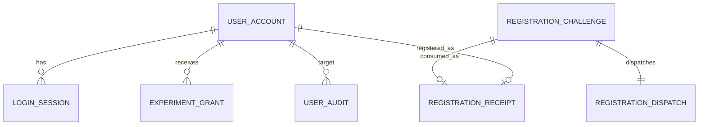

# SDD-002 数据库详细设计

日期：2026-09-30。状态：设计稿，未执行迁移，不表示账号功能已经实现。
主规格：[邮箱注册与用户管理](2026-09-30-sdd002-user-account-design.md)。

## 1 统一约定

沿用MySQL 8、InnoDB和各服务独立数据库。用户表只放stock_user，邮件表只放stock_notification；不使用跨库外键和跨库联表。迁移分别从本服务V1开始，不改变行情服务已执行的V1/V2。

ID采用应用生成的UUID，CHAR(36) ASCII二进制排序规则；API以字符串传输。邮箱最长254字符，首批支持ASCII邮箱；去首尾空格后小写得到email_normalized，使用ASCII二进制排序规则及唯一索引。昵称2—30个Unicode码点，禁止控制字符；前端校验不代替服务端校验。

时间使用UTC DATETIME(3)，Java Instant由数据访问层明确转换；JDBC及会话时区设置为UTC。有效条件为now < expires_at，等于过期时刻即失效。revision/credential_version为BIGINT非负数，以事务原子更新，不从客户端采纳新版本值。

摘要用CHAR(64) ASCII二进制排序规则保存SHA-256/HMAC-SHA-256十六进制结果；随机会话原文不入库。密码哈希VARCHAR(100)，不可用于普通DTO。敏感邮件载荷采用AES-GCM，nonce每次随机，保存key_id、nonce和密文；密钥只经环境注入，缺少有效密钥时拒绝派发，不保存明文替代。

状态用VARCHAR加CHECK，不使用难扩展的MySQL ENUM。所有可重试状态另设attempt/version/fencing数据，不能仅凭一个状态字符串防止重复提交。

下文未明确标NULL的状态、计数、版本、ID及创建时间均为NOT NULL；nonce、密文和key_id必须一起存在或一起为空。email_delivery的last_attempt_at在尚未尝试时允许NULL；registration_dispatch的next_attempt_at非空。敏感载荷被清理后，只能进入不会再次需要该载荷的终态，不能把已清理记录重新入队。

## 2 用户服务数据表

### 2.1 user_account

user_id CHAR(36) PK；email VARCHAR(254) NOT NULL；email_normalized VARCHAR(254) ASCII COLLATE ascii_bin NOT NULL UNIQUE；email_verified_at DATETIME(3) NOT NULL；email_version BIGINT NOT NULL DEFAULT 1；password_hash VARCHAR(100) NOT NULL；role_code VARCHAR(16) NOT NULL CHECK IN(USER,ADMIN)；status VARCHAR(16) NOT NULL CHECK IN(ENABLED,DISABLED)；nickname VARCHAR(120) NOT NULL；avatar_uri VARCHAR(512) NULL；credential_version BIGINT NOT NULL DEFAULT 1；revision BIGINT NOT NULL DEFAULT 0；created_at DATETIME(3) NOT NULL；last_active_at DATETIME(3) NULL。

索引：(status,user_id)、(role_code,user_id)。注册只写USER；初始化ADMIN由受控命令创建，无默认口令。email_verified_at非空是本批“验证后建账号”的物理约束，后续换邮箱需有独立pending地址，不将已验证登录地址直接替换为未验证地址。

SQL关键约束：

```sql
UNIQUE KEY uk_user_email (email_normalized),
CHECK (role_code IN ('USER','ADMIN')),
CHECK (status IN ('ENABLED','DISABLED')),
CHECK (credential_version >= 1 AND revision >= 0 AND email_version >= 1)
```

### 2.2 registration_challenge

challenge_id CHAR(36) PK；email_normalized VARCHAR(254) ASCII COLLATE ascii_bin NOT NULL；code_digest CHAR(64) NOT NULL；digest_key_id VARCHAR(32) NOT NULL；purpose VARCHAR(16) NOT NULL CHECK='REGISTER'；expires_at DATETIME(3) NOT NULL；failed_attempts INT NOT NULL DEFAULT 0 CHECK>=0；consumed_at DATETIME(3) NULL；invalidated_at DATETIME(3) NULL；created_at DATETIME(3) NOT NULL。

索引：(email_normalized,created_at)、expires_at。没有user_id外键。读取并消费使用SELECT ... FOR UPDATE；通过user_account唯一邮箱约束作为第二道保护。HMAC输入包含challenge_id、email_normalized、purpose、验证码，避免不同挑战摘要混用。失效和消费不删除记录，以保留回执关联与诊断。

### 2.3 registration_dispatch

request_id CHAR(36) PK；challenge_id CHAR(36) NOT NULL UNIQUE FK registration_challenge；state VARCHAR(16) CHECK IN(PENDING,CLAIMED,ACCEPTED,FAILED,EXPIRED)；attempt_count INT NOT NULL DEFAULT 0；next_attempt_at DATETIME(3)；lease_until DATETIME(3) NULL；claim_version BIGINT DEFAULT 0；payload_ciphertext BLOB NULL；payload_nonce BINARY(12) NULL；payload_key_id VARCHAR(32) NULL；expires_at DATETIME(3) NOT NULL；last_error_code VARCHAR(64) NULL；created_at DATETIME(3) NOT NULL；updated_at DATETIME(3) NOT NULL。

索引：(state,next_attempt_at)、expires_at。ACCEPTED表示消息服务已持久受理，不能解释为邮件已送达。SMTP发送状态通过消息服务接口读取。claim_version限制旧派发执行者覆盖新认领；同request_id跨服务重试，不能生成新请求ID。ACCEPTED或EXPIRED清除加密载荷；终态失败在有效期内可按同请求重试，不重复建验证码。

### 2.4 registration_receipt

registration_request_id CHAR(36) PK；challenge_id CHAR(36) NOT NULL UNIQUE FK registration_challenge；user_id CHAR(36) NOT NULL FK user_account；public_request_digest CHAR(64) NOT NULL；created_at DATETIME(3) NOT NULL。

公开摘要由challenge_id、规范化邮箱、昵称计算，不含密码和验证码。成功重试需匹配回执请求ID及公开摘要，不再次更新密码，不返回用户邮箱等资料。不同请求ID使用已消费挑战拒绝。回执保留至少30天，随后清理有明确配置，不能删除用户记录。

### 2.5 login_session

session_id CHAR(36) PK；user_id CHAR(36) NOT NULL FK user_account；token_hash CHAR(64) NOT NULL UNIQUE；credential_version BIGINT NOT NULL；expires_at DATETIME(3) NOT NULL；revoked_at DATETIME(3) NULL；created_at DATETIME(3) NOT NULL。

索引：(user_id,revoked_at)、expires_at。会话固定8小时有效，无滑动续期。每个受保护请求核验用户ENABLED、会话未撤销、now<expires_at以及credential_version一致，不以单个token存在代表授权。查询摘要不打印原凭据。

### 2.6 experiment_grant

grant_id CHAR(36) PK；user_id CHAR(36) NOT NULL FK user_account；granted_by CHAR(36) NOT NULL FK user_account；state VARCHAR(16) CHECK IN(ACTIVE,REVOKED)；granted_at DATETIME(3) NOT NULL；revoked_at DATETIME(3) NULL；active_user_id CHAR(36)生成列；UNIQUE(active_user_id)。

```sql
active_user_id CHAR(36) CHARACTER SET ascii COLLATE ascii_bin
  GENERATED ALWAYS AS (CASE WHEN state = 'ACTIVE' THEN user_id ELSE NULL END) STORED,
UNIQUE KEY uk_one_active_grant (active_user_id)
```

MySQL允许多个NULL，因此可保留多条撤销历史，又能限制每用户一个有效授权。授予/撤销锁定目标用户并核验revision；幂等无变化时不增加revision，返回当前值。ADMIN权限单独核验，不依靠授予实验权限来获得管理能力。

### 2.7 user_audit

audit_id CHAR(36) PK；operator_id CHAR(36) NULL FK user_account；target_id CHAR(36) NOT NULL FK user_account；action VARCHAR(32) NOT NULL；result VARCHAR(16) NOT NULL；trace_id VARCHAR(64) NOT NULL；occurred_at DATETIME(3) NOT NULL。索引：(target_id,occurred_at)、(operator_id,occurred_at)。

初始化记录operator_id=NULL、action=ADMIN_BOOTSTRAP；普通管理成功变更与审计同事务。拒绝请求记安全日志，不伪造成功审计；不保存密码、验证码、邮件载荷或会话Cookie。

### 2.8 auth_rate_bucket

bucket_key CHAR(64) PK（用途及规范化邮箱/可信来源地址的HMAC）；scope VARCHAR(32) NOT NULL；window_started_at DATETIME(3) NOT NULL；window_ends_at DATETIME(3) NOT NULL；request_count INT NOT NULL DEFAULT 0；last_request_at DATETIME(3) NULL；revision BIGINT NOT NULL DEFAULT 0。索引：window_ends_at。

初始采用从首次请求开始的固定计数窗口，不声称滚动窗口。发送计数1小时，登录失败15分钟；同邮箱60秒发送间隔独立检查。新增桶用INSERT ... ON DUPLICATE KEY UPDATE确保行存在，再FOR UPDATE；多个桶按bucket_key升序锁定，所有计数更新同事务。接口失败是否计次按类别规定：SMTP失败占申请次数，格式非法不建邮箱桶但计来源桶；登录认证失败计失败数，成功不清除来源地址总体限制。

同邮箱挑战申请也锁对应邮箱发送桶，保证两个并发请求不能同时通过60秒限制，并使旧挑战失效。计数持久化，重启不清零；过期桶分批清理。

### 2.9 bootstrap_guard

guard_key VARCHAR(32) PK；created_at DATETIME(3) NOT NULL。迁移只插入guard_key=ADMIN_INIT这一条锁记录，不插入账号或密码。初始化事务FOR UPDATE锁此行，确认不存在ADMIN后创建管理员与审计；第二个初始化进程被串行化后拒绝。回滚不留下半个管理员。

## 3 消息服务email_delivery

delivery_id CHAR(36) PK；request_id CHAR(36) NOT NULL UNIQUE；challenge_id CHAR(36) NOT NULL（跨服务REF，无FK）；recipient_email VARCHAR(254) NOT NULL；template_code VARCHAR(32) NOT NULL；state VARCHAR(16) CHECK IN(PENDING,CLAIMED,SENT,FAILED,EXPIRED)；attempt_count INT NOT NULL DEFAULT 0；next_attempt_at DATETIME(3) NOT NULL；lease_until DATETIME(3) NULL；claim_version BIGINT NOT NULL DEFAULT 0；payload_ciphertext BLOB NULL；payload_nonce BINARY(12) NULL；payload_key_id VARCHAR(32) NULL；payload_digest CHAR(64) NOT NULL；expires_at DATETIME(3) NOT NULL；last_error_code VARCHAR(64) NULL；created_at DATETIME(3) NOT NULL；last_attempt_at DATETIME(3) NULL。

索引：(state,next_attempt_at)、expires_at。同request_id且同payload_digest返回原delivery；不同载荷返回REQUEST_CONFLICT。payload_digest用HMAC，不能给短验证码提供离线普通哈希。邮件服务只收受控REGISTER_CODE模板，不开放任意邮件正文代理。

通过短事务认领并递增claim_version，事务外SMTP发送，再WHERE request_id=? AND claim_version=? AND state='CLAIMED'提交结果。SENT仅指SMTP接受，不代表收件人收到。worker崩溃且SMTP实际已接收时可能重复发送同码，不能承诺Exactly Once。逾期禁止重发，SENT/EXPIRED清除敏感载荷；有界重试初始最多3次，延迟5/30/120秒，优先检查剩余验证码有效期。

邮件调度器是消息服务本地投递恢复机制，不创建第二套用户训练任务队列；MS-04继续拥有全系统业务任务。后续公共运维统计由接口汇总投递记录。

## 4 事务与竞态

注册顺序：邮箱发送桶锁 → 挑战锁 → 查成功回执 → 检查/创建账号 → 回执 → 消费挑战。邮箱桶为同邮箱申请/注册共同串行点；不同邮箱无全局锁。验证失败返回结果对象，让错误计数事务提交后由Controller映射业务错误，不能在同事务抛异常回滚计数。

登录与禁用：BCrypt比对可在事务外执行；成功建会话前锁用户行，再检查status、password_hash/credential_version未改变。禁用、改密码同样锁用户行并递增版本、撤销会话，因此不会在禁用后又建立有效旧会话。

修改昵称/管理员变更使用WHERE user_id=? AND revision=?更新，受影响行数0为409。授权操作锁目标用户，防止昵称更新和授权更新不同步；禁止接受客户端新revision。

数据库异常经统一异常体系转换；唯一邮箱冲突返回通用注册失败，不泄露数据库约束名。事务失败无成功业务结果，外部邮件调用不能放在长数据库锁事务内。

## 5 图与迁移入口



消息服务EmailDelivery通过request_id/challenge_id关联派发记录，仅为REF，不加入上述本库外键图。图仅覆盖本批，不替代全系统自选股与持仓ER。

实施时创建用户服务V1__account_auth.sql和消息服务V1__email_delivery.sql，添加Flyway core/MySQL支持并验证空库与重复启动。本轮未创建生产迁移文件、未执行SQL；原PNG/SVG仍待按全量实体同步渲染，不作为本批DDL依据。

## 6 数据库验收

独立MySQL测试库验证：规范化邮箱唯一、challenge无用户外键、一个有效实验授权、回执唯一、计数并发、管理员初始化并发、登录与禁用竞态、SMTP认领旧版本不能覆盖、服务账号跨库拒绝。禁止用H2通过替代这些MySQL8行为。

测试库使用明确test前缀并单独配置，测试脚本不得truncate当前stock_user/stock_notification或删除本机Compose业务卷。测试失败保留诊断证据，不能改写Flyway已执行历史来凑通过。
