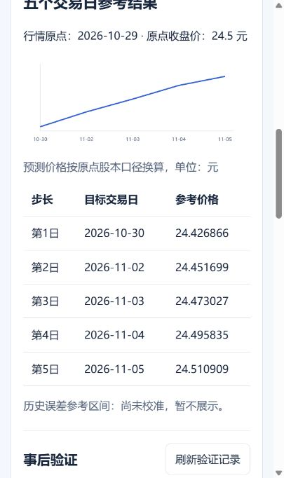

# 核心业务链路修复与验收（2026-10-29—30）

本轮覆盖行情更新→技术指标→五交易日预测→结果保存→实际行情验证，并检查自选、持仓和预警的衔接。已本机部署，不代表13项业务全部开发完成。开题报告、任务书和需求正文未修改。

## 已修复的问题

- 准备预测输入前，若RAW自身日历已经明确证明行情过期，返回FORECAST_INPUT_STALE，不再为过期窗口访问复权源。日历不足UNKNOWN继续同源核验；最终新预测必须FRESH。历史显式输入和真实验证入口保留。
- 将行情过期、日历不足、60日样本不足、源超时、源不可用和源校验失败区分展示。只传播安全白名单码，不展示上游原始响应。失败不伪造预测或覆盖历史结果。
- 现场发现预测解释首次加载会自动调用MaaS。实际意外触发1次，已当场告知用户并记录，不能宣称本轮零AI调用。现改为仅用户点击生成；挂载、刷新、切换记录和账号都不自动生成，未知结果继续使用原编号。刷新后的操作数仍为1，没有追加；未测量云端实际计费金额。

## 真实链路验收

三只预设股票SH600030、SH600276、SZ000002均通过原管理员入口各登记一项任务，全部一次尝试SUCCEEDED；覆盖从2025-01-02接续至2026-10-29。上海时区20点前只核验至昨日。历史RAW版本仍AVAILABLE。成功路径每项包含日线和日历两个逻辑查询方法，未审计全部网络报文；诊断请求和后台自然任务另计，不冒充三项业务任务的次数。

中信证券新RAW为ebaacd08-f124-4144-8f8e-ee623586392a，日线和MA/MACD/RSI正常。已发布Transformer模型基于2026-10-29原点生成五点，预测编号69c60fe0-fbb5-4c2e-a65f-e83f4d23bb92；输入e8818d5e-1950-4f5f-a8e1-db89b1bc968b。目标交易日为10月30日、11月2/3/4/5日。浏览器重新打开并刷新后仍显示原五点；服务端模型及预测快照SHA256为0b4bf19171111a5803de057f2ba9fa88c3b37325aff32db9137be5d6bff30f20，前后相同。

新RAW修订自动触发旧预测19ddcb7c-3fba-4df3-ba4f-f8eebfeb3f14重新核验。当前验证版本4419b286-a867-44e2-a873-ec3b8aac001f，真实证据21f9531d-5044-4519-b763-0ff266e67f27，引用上述新RAW，verifiedCount=5，调度任务成功。旧预测不被改写，验证追加版本。

新预测尚未到验证截止时点的目标显示“尚未到期”，不预填未来实际价格。到期后沿用既有每日验证任务；历史五点核验成功不代表新预测准确率已确定。

## 自选、持仓与预警

- 生产自选卡显示中信证券截至10月29日的收盘价，分析和预测链接正确，原关注记录保留。
- 已有持仓及10月19日估值、问答历史均可读取，保留原账本版本、数据日期和数值。不会因新行情更新而改写旧估值。本轮未修改数量/成本、生成新估值或发送持仓问题；估值跨版本、缺失和日期边界由本轮隔离回归验证。
- 分析页预警链接传入SH600030，现有停用规则仍停用。规则生效日期、已完成交易日、RAW版本、同日去重及账户边界均由隔离测试覆盖。本轮未新建/启用规则或发送邮件；不能把代码和只读检查说成真实邮件端到端验收。
- 本轮生产使用管理员原账号；普通账号未再次重登，角色及用户隔离由HTTP/数据库回归验证。

## 测试与部署

后端公共54、用户99、市场258、预测255、调度276、通知113，共1055项本轮验证通过。首轮用户模块成功后市场模块因测试库不存在失败；测试MySQL是内存盘，重启后需执行scripts/start-auth-test-db.ps1补建其余库。恢复后其余四业务模块完整BUILD SUCCESS，不把环境失败算作通过，也不虚构单次五模块统一成功命令。

最终前端73文件343项、类型检查与构建通过。先观察RAW过期检查、错误传播以及自动生成禁止测试失败，再修复转绿。前端大分块警告仍属既有待优化项。本轮后端未修改后不重复回归，现场解释修复后重跑了全部前端。

市场、预测及前端已部署，运行JAR和index.html指纹与构建一致。七应用健康；原库卷与旧镜像回滚标签保留，未新增数据库迁移。三项人工行情任务完成后，临时重取开关恢复false，八项原调度开关逐项核对保持。备份还原演练不在本轮范围。

## 外部源诊断与限制

10月29日和30日均观察到25秒SOURCE_TIMEOUT，未发布空数据；TCP连接成功但SDK登录等待响应。30日主机与容器随后先后登录成功，同一容器受限采集0.77秒返回截至29日真实行情，三项实际更新也成功。由此只能确认间歇性故障恢复，不能认定固定Docker配置错误、供应商永久故障或永久稳定。未改SDK源码、未绕过新鲜度检查或混入合成价格。[官方包示例](https://pypi.org/project/baostock/)使用的登录调用与本项目相同。

误差区间仍未校准。旧InstrumentDetail.forecastCapability存在历史占位表述，当前前端依已发布模型目录决定预测支持，未使用该占位字段；接口语义清理列为低优先级待办。本轮未扩大训练、股票池、模型发布或版本停用范围。

## 独立终审

原修复Critical0/Important0/Minor2，边界断言和README均补齐。现场解释修复补审Critical0/Important0/Minor1，新增未知操作经只读刷新后仍复用编号的测试已通过。

结构化证据见[evidence/core-chain-20261030-verification.json](evidence/core-chain-20261030-verification.json)，运行原始日志留在本机忽略目录runtime/core-chain-20261029，不含在版本提交中。

